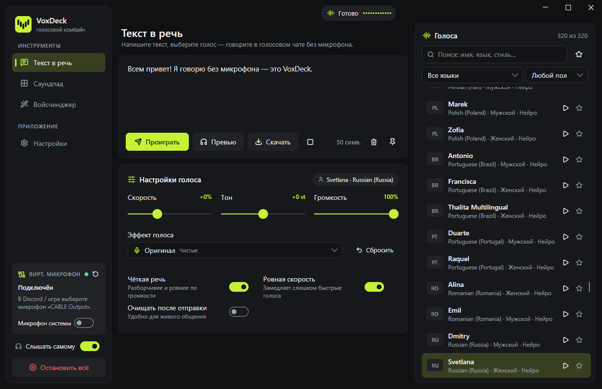
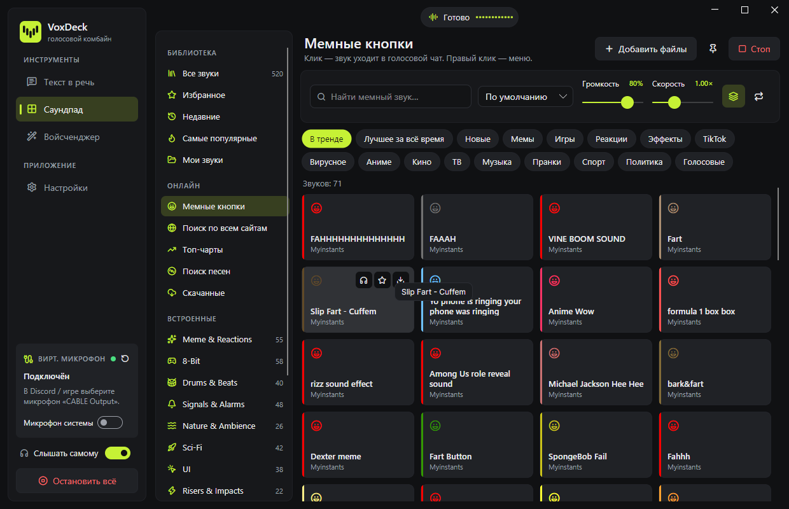
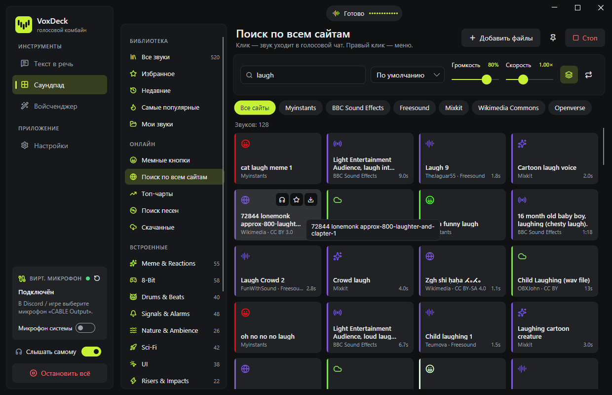
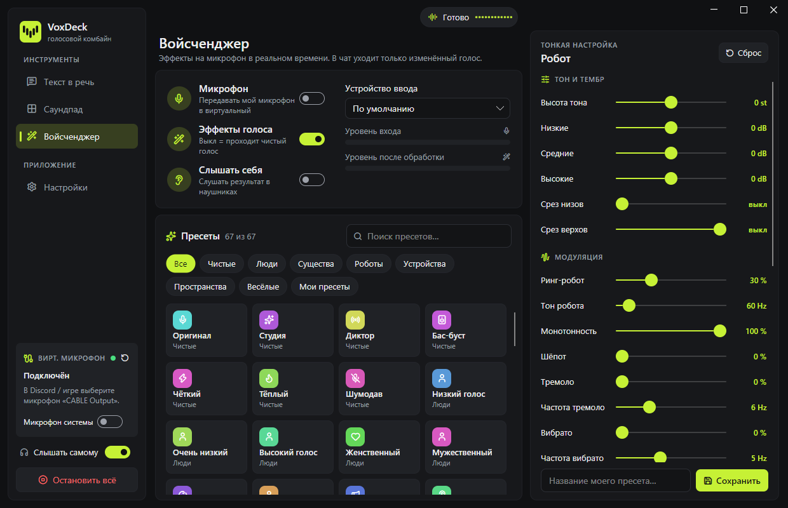
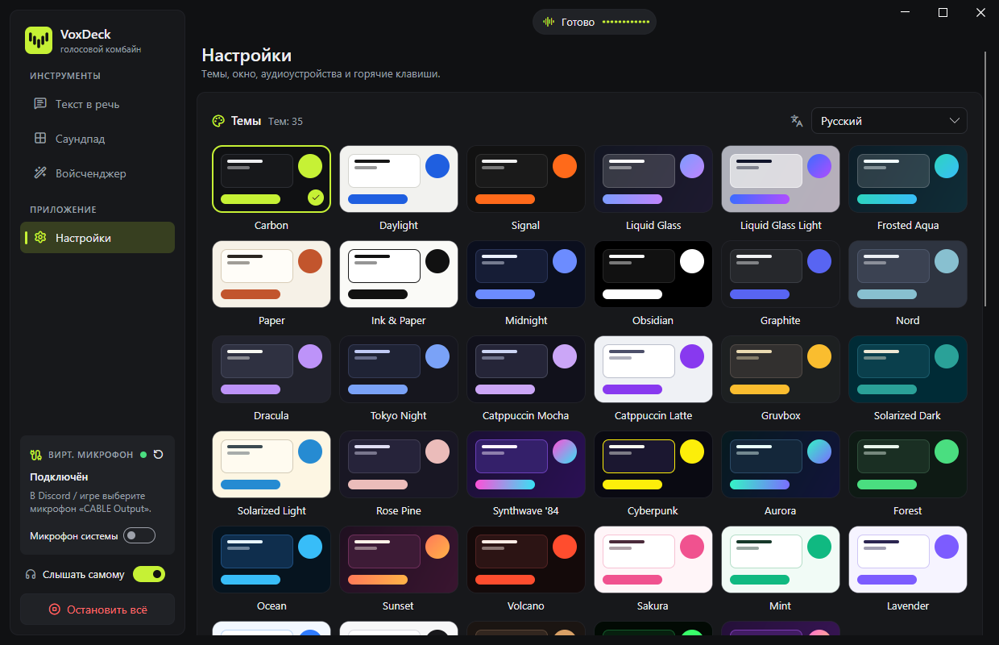
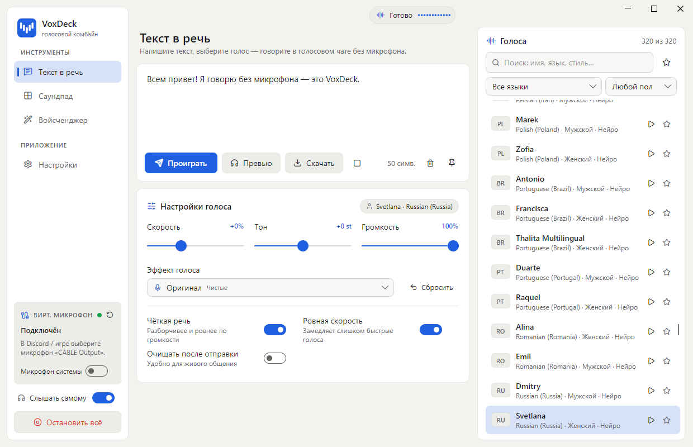
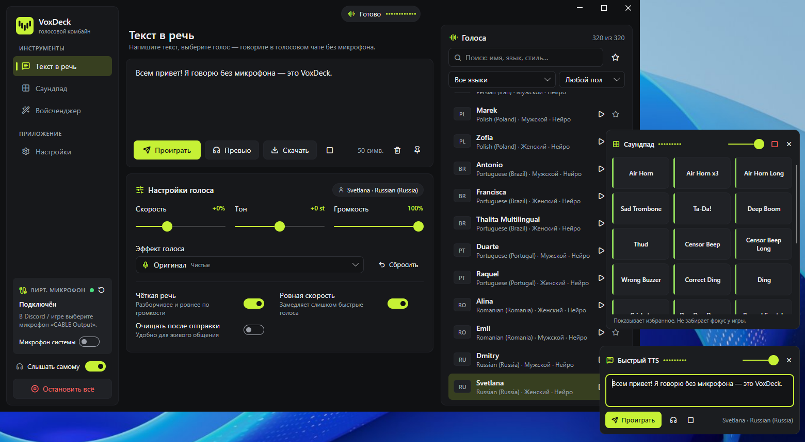

# VoxDeck — текст в речь · саундпад · войсченджер

Обычное приложение Windows 10/11 (64-бит): один файл `VoxDeck.exe`, без установки, без браузера внутри.
Говорите в Discord, Telegram, Steam и играх без микрофона, включайте мемные звуки и меняйте голос.

**Скачать:** [последний релиз → VoxDeck.exe](https://github.com/ccvqo0/voxdeck/releases/latest)

## Виртуальный микрофон — одной кнопкой

Чтобы другие программы слышали VoxDeck, Windows нужен драйвер виртуального аудиоустройства
(так же работают Voicemod и Soundpad). Ставить его руками не надо:

1. Нажмите **«Установить драйвер»** в левой панели.
2. VoxDeck скачает бесплатный подписанный драйвер VB-CABLE с сайта производителя (vb-audio.com),
   проверит цифровую подпись файла и запустит установку. Windows один раз спросит разрешение — согласитесь.
3. Готово: индикатор «Вирт. микрофон» становится зелёным.

Дальше два варианта:

- включите переключатель **«Микрофон системы»** — VoxDeck становится микрофоном Windows по умолчанию,
  и программы подхватывают его сами. Ваш настоящий микрофон (если он есть) продолжает работать через VoxDeck.
  При закрытии VoxDeck прежний микрофон возвращается на место;
- или выберите микрофон **«CABLE Output»** в настройках Discord / игры.

Удалить драйвер можно в «Настройках» VoxDeck.

## Что умеет

| Вкладка | Возможности |
|---|---|
| **Текст в речь** | 318 нейроголосов, 142 языка и акцента, плюс системные голоса Windows. Первый звук обычно через 0,2–0,5 с: фраза готовится, пока вы печатаете. Длинный текст читается по предложениям без пауз. «Чёткая речь» выравнивает громкость и разборчивость, «Ровная скорость» замедляет слишком быстрые голоса. Скорость, тон и громкость запоминаются для каждого голоса отдельно. Любой из 67 эффектов голоса. |
| **Саундпад** | Мемные кнопки Myinstants: тренды по странам, лучшее за всё время, новые, 14 категорий. Поиск сразу по шести сайтам: Myinstants, BBC Sound Effects, Freesound, Mixkit, Wikimedia Commons, Openverse. Топ-чарты и поиск песен (30-секундные фрагменты Deezer). 520 встроенных звуков без интернета. Свои файлы MP3 / WAV / OGG / FLAC. Избранное, недавние, горячая клавиша на любой звук. |
| **Войсченджер** | Меняет голос с микрофона на лету, в чат уходит только изменённый. 67 пресетов, 26 ручных параметров, свои пресеты. |
| **Настройки** | 35 тем (плоские Carbon, Daylight, Signal и стеклянные), прозрачность окна, поверх всех окон, устройства, горячие клавиши, язык English / Русский. |

Кнопка-булавка открывает маленькое окно TTS или саундпада поверх игры.

| | |
|---|---|
|  |  |
|  |  |
|  |  |

Все скриншоты сняты автоматически на настоящей Windows во время сборки.

## Что проверено

Каждая сборка проходит на чистой машине с Windows (GitHub Actions, Windows Server 2025):
готовый `VoxDeck.exe` запускается и сам себя проверяет. Журнал и скриншоты лежат во вкладке
[Actions](https://github.com/ccvqo0/voxdeck/actions) → нужный запуск → артефакт `test-report`.

Проверяется автоматически:

- установка драйвера самим VoxDeck: скачивание, проверка подписи, появление устройств «CABLE Input» и «CABLE Output»;
- звук и речь, проигранные в VoxDeck, записываются с «CABLE Output» — то есть доходят до виртуального микрофона;
- все 318 голосов в списке, синтез короткой и длинной фразы, задержка до первого звука;
- все онлайн-источники: поиск и скачивание звука с каждого сайта;
- 520 встроенных звуков и 67 пресетов.

Не проверено, потому что на сборочной машине этого нет:

- настоящий микрофон: войсченджер на живом голосе и передача вашего микрофона через VoxDeck;
- возврат прежнего микрофона по умолчанию, когда он в системе есть;
- окно разрешения Windows при установке драйвера, нажатое человеком (на сборочной машине издатель драйвера добавлен в доверенные заранее);
- сам Discord и игры;
- глобальные горячие клавиши, размытие стеклянных тем, Windows 10.

## Полезно знать

- Файл не подписан, поэтому SmartScreen при первом запуске может предупредить: «Подробнее» → «Выполнить в любом случае».
- Нейроголоса и онлайн-звуки требуют интернета и работают через открытые сервисы (Microsoft Edge Read Aloud, Myinstants, BBC, Freesound, Mixkit, Wikimedia, Openverse, Deezer). Сервисы могут менять правила доступа. Встроенные звуки, системные голоса и войсченджер работают без сети.
- Звуки с сайтов принадлежат их авторам. Архив BBC Sound Effects разрешён для личного, учебного и исследовательского использования.
- VB-CABLE — бесплатный (donationware) драйвер компании VB-Audio; VoxDeck его не содержит, а скачивает с сайта производителя.
- Если VoxDeck завершился аварийно при включённом «Микрофоне системы», микрофоном по умолчанию останется «CABLE Output». Запустите VoxDeck снова и закройте его обычным способом либо выберите свой микрофон в параметрах звука Windows.
- Настройки и кэш звуков хранятся в `%AppData%\VoxDeck`.

## Сборка из исходников

Нужен .NET SDK 8 или новее. Запустите `build.cmd` — получится `publish\VoxDeck.exe`.

Сделано на C# / .NET 8, Avalonia 11 (векторный интерфейс), NAudio (WASAPI).
